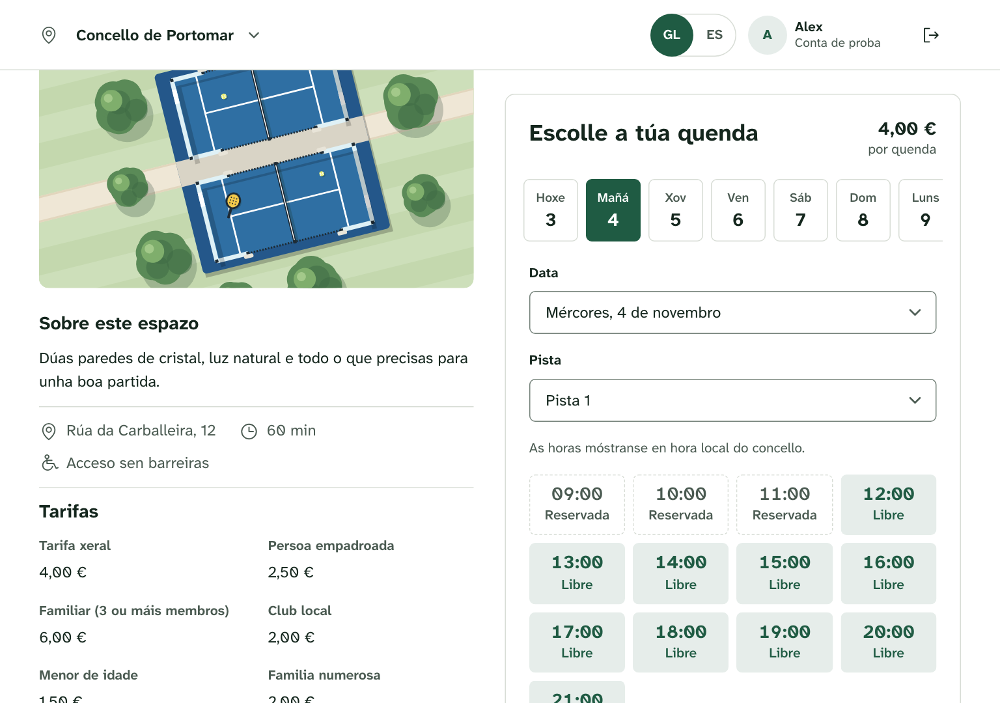
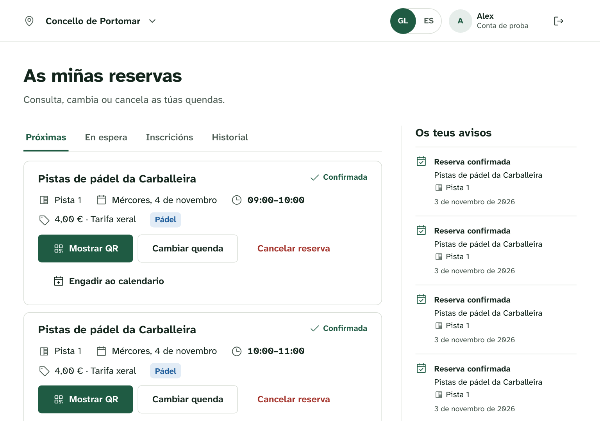
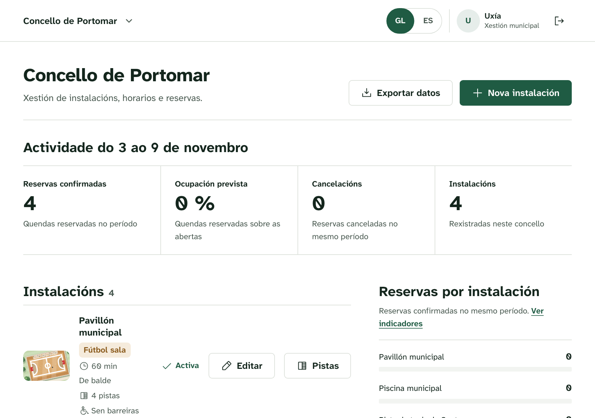
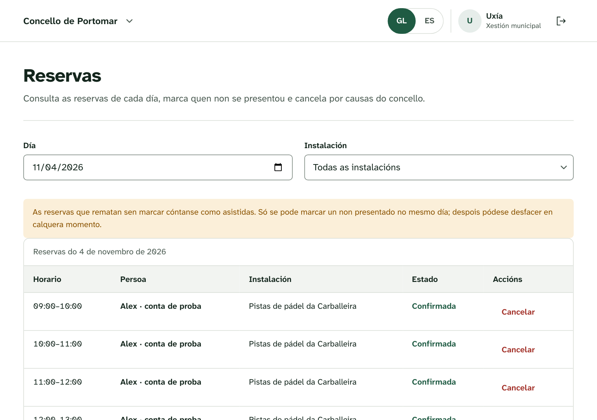
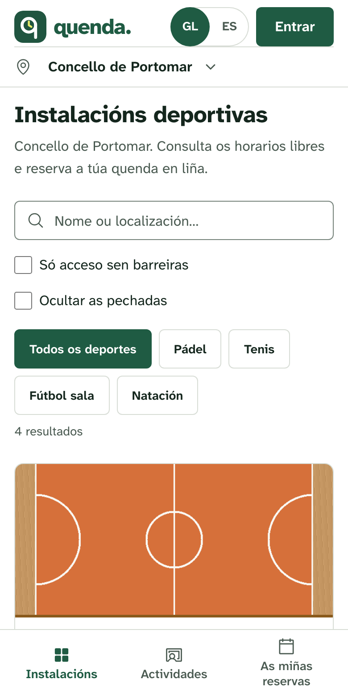

<!--
SPDX-License-Identifier: AGPL-3.0-or-later

Fonte da memoria técnica (#28). `npm run memoria` enche con este texto a plantilla oficial v3
(plantilla_memoria_tecnica_gobtec_2026.odt) e exporta memoria-tecnica.odt e memoria-tecnica.pdf.
Os títulos `##` e `###` son os da plantilla, letra por letra. O texto de cada apartado substitúe a
súa caixa «[…]»; as táboas dos apartados 0 e 4 van, fila a fila, ás táboas da plantilla, e as
casillas do apartado 9 márcanse con [x]. As imaxes levan o ancho en centímetros: {8}.
Unha liña só con imaxes ponas unha ao carón da outra. [PENDENTE] marca o que falta antes do envío.
-->

## 0. Datos de identificación da entidade

| Campo | Valor |
| --- | --- |
| Nome / razón social | TIMETIME SOFTWARE, SL (NIF B72969850) |
| Forma xurídica | Sociedade limitada (SL) |
| Concello / provincia | Pontevedra (Pontevedra). Domicilio social: Praza de Barcelos 27, 7B, 36002 Pontevedra |
| Nome da proposta | Quenda: reserva en liña de instalacións deportivas municipais |
| Persoa de contacto | David Pombar |
| Teléfono de contacto | 619 51 04 77 |
| Correo electrónico | info@timetime.in |
| Web / portfólio (opcional) | Código: https://github.com/DavidPombar/quenda · Demo: https://91-99-68-27.sslip.io/ |

## 1. Resumo executivo

Quenda é unha plataforma libre (AGPL-3.0) para que a veciñanza consulte as instalacións deportivas do seu concello, vexa a dispoñibilidade real e reserve, cambie ou cancele unha quenda desde o móbil, sen chamar nin desprazarse. O concello xestiona desde o mesmo sistema instalacións, horarios en iCalendar, normas, tarifas, tempadas de clubs e indicadores, e unha deputación pode dar servizo a moitos concellos nunha soa instalación, cos datos illados. Está pensada para o concello pequeno: instálase cunha orde nun servidor Linux, funciona en galego e castelán, admite Cl@ve/Chave365 mediante OpenID Connect e foi deseñada para WCAG 2.1 AA. Non é un deseño sobre papel: o código é público e a demo funciona hoxe con datos ficticios. Resolve o problema que describen as bases: reservas por teléfono, correo ou mostrador, sen visibilidade da dispoñibilidade e con cancelacións lentas.

## 2. Comprensión do reto

**O problema.** Investigamos como reservan hoxe os concellos galegos (investigación completa no repositorio, `docs/investigacion`). Santiago, Lugo e Abegondo usan un formulario ou unha solicitude na sede electrónica, sen reserva en tempo real; Catoira, Castrelo do Val e Avión, o teléfono, a biblioteca ou a chave no concello. Ningunha deputación ofrece unha plataforma de reservas deportivas. As alternativas comerciais para concellos pequenos son SaaS de 310 a 1.200 € ao ano: ningunha integra Cl@ve nin Chave365, ningunha declara WCAG e case ningunha está en galego. As grandes suites esixen alta presencial, e o reparto anual de horas aos clubs faise a man e por correo mesmo en A Coruña, Vigo ou Santiago.

**Quen o sofre.** A veciñanza non sabe se hai pista ata que chama, e cancelar custa máis que non presentarse, polo que as quendas baleiras non se aproveitan. O persoal de deportes atende o teléfono, apunta en follas de cálculo e non ten datos para decidir. O concello pequeno non ten departamento de informática nin orzamento para unha licenza anual por cada instalación.

**Como o aborda Quenda.**

- **Dispoñibilidade real sempre visible**, calculada no momento a partir do horario de apertura, das reservas, das tempadas e dos peches, sen calendarios copiados a man.
- **Reservar, cambiar ou cancelar sen intervención do persoal**, coas normas que fixa cada concello: antelación, prazo de cancelación, límites por persoa e penalización por non presentarse. Unha praza que queda libre ofrécese á lista de espera, así que as cancelacións si se aproveitan.
- **Un backoffice que se aprende nunha mañá**, coas tarefas do día: reservas, peches con aviso automático a quen reservou, porta con QR e indicadores descargables.
- **Pensada para quen non ten técnicos**: unha deputación pode instalala unha vez e dar de alta os concellos, cada un coa súa imaxe, normas e datos separados; un concello tamén pode instalala só, nun servidor de 2 vCPU e 4 GB.
- **Sen barreiras de entrada**: Cl@ve/Chave365 cando o concello a teña, e mentres tanto un código dun só uso por correo; galego por defecto, castelán e accesibilidade desde o primeiro día.

A demo publicada (apartado 8) xa fai todo o anterior con dous concellos ficticios. A proposta non pide confiar nun deseño: pódese probar.

## 3. Cobertura funcional

### 3.1 Funcionalidades para a cidadanía

- **Consulta de instalacións (C1).** Catálogo común a todos os concellos da instalación, con buscador, filtros por deporte e por acceso sen barreiras, fotos con texto alternativo, mapa, normas, prezos por categoría e horario da semana.
- **Reserva en liña (C2).** Dispoñibilidade por día e pista. O servidor impide os solapamentos, mesmo con dúas persoas reservando á vez (bloqueo na base de datos), e coñece as pistas divididas en partes que se bloquean entre si e as rúas ou salas con aforo, onde varias persoas comparten a quenda e a app di cantas prazas quedan. Aplica a antelación, os límites por persoa e a tarifa da súa categoría (empadroada, familia numerosa, club local…). Se o día está cheo, suxire tres quendas libres a partir do histórico agregado, sen IA, e permite apuntarse á lista de espera: cando queda libre unha praza, gárdase para a primeira persoa e avísase.
- **Modificación e cancelación (C3).** Cambio de quenda e cancelación desde «As miñas reservas», dentro do prazo do concello; a quenda liberada ofrécese á lista de espera.
- **Historial e avisos (C4).** Próximas reservas, historial e avisos na app, por correo e por Web Push para confirmacións, cambios, cancelacións (tamén as do concello, co motivo), lembranzas e ofertas da lista de espera. Cada persoa escolle que avisos e por que canle.

{8.1} {8.1}

### 3.2 Funcionalidades para o concello

- **Alta e mantemento de instalacións (M1).** Instalacións e as súas pistas ou rúas (con aforo opcional), fotos, coordenadas e estados activa, en mantemento e pechada. Un peche cun motivo cancela as reservas afectadas e avisa a quen as fixo.
- **Xestión de horarios e normas de uso (M2).** Horarios de apertura en iCalendar (RFC 5545) con excepcións e importación de `.ics`, festivos locais, duración das quendas, antelación, prazo de cancelación, límites por persoa, tarifas por categoría coa súa verificación e penalización por ausencias. O **reparto de tempadas entre clubs** reserva as horas fixas de cada club durante a tempada e sinala as datas que chocan con reservas ou co horario. As actividades e escolas deportivas (cursos con prazas, inscrición en liña e lista de espera) ocupan a pista nas súas sesións.
- **Información e seguimento mediante indicadores básicos (M3).** Reservas, cancelacións e ocupación por instalación, pista, día da semana e hora, asistencia e non presentacións, ofertas da lista de espera aceptadas e caducadas, con comparación de períodos e descarga CSV. As **reservas do día** permiten marcar ausencias e cancelar por causas do concello, e a **páxina da porta** le o QR do pase, tamén sen conexión.

{8.1} {8.1}

### 3.3 Reutilización pública e multi-municipio

- **Configuración por municipio, sen tocar código (R2).** Nome, logotipo, cores e icona da app, idioma por defecto, correo de contacto e remitente, textos legais e aviso de privacidade versionados, declaración de accesibilidade, categorías e tarifas, normas de reserva e cancelación, penalizacións, lista de espera, prazos de conservación e licenza dos datos abertos.
- **Multi-municipio con illamento estrito (R3).** Unha instalación serve a moitos concellos; o concello sae sempre da sesión e cada consulta vai filtrada por el, comprobado con probas automáticas. A **entidade operadora** (por exemplo, unha deputación) dá de alta concellos e persoas xestoras e ve indicadores agregados; cada xestor/a só ve o seu concello, e o persoal da porta só a porta.
- **Concellos de distinto tamaño (R1).** Un concello cunha pista de pádel usa o catálogo e as reservas; un maior engade tempadas, actividades, control de accesos e analítica. Os módulos opcionais (Cl@ve, analítica Umami, integración con fechaduras) actívanse por configuración e non estorban se non se usan.

### 3.4 Aspectos valorables adicionais (opcional)

- **App móbil instalable (PWA)** co nome, a cor e a icona de cada concello, sen tendas de aplicacións, con avisos Web Push.
- **Calendarios persoais**: cada reserva en `.ics` e unha subscrición `webcal://` revogable que se actualiza soa.
- **Acceso con código QR**: pase asinado que funciona sen conexión, páxina da porta para o persoal e un *webhook* para fechaduras ou luces.
- **Analítica de uso** sen cookies no Umami da propia instalación (opcional) e **recomendación horaria** de tres quendas libres calculada con estatística sobre datos agregados.
- **Datos abertos** do catálogo en CSV, GeoJSON e JSON-LD de schema.org, cun catálogo DCAT-AP-ES para datos.gob.es e abertos.xunta.gal.
- **Intelixencia artificial: non se usa.** A recomendación é estatística, non se envía ningún dato a terceiros e non hai ningún modelo que substituír.

{3.6}

**Trazabilidade dos requisitos.** Cada issue, cambio e documento do repositorio cita o identificador que cobre:

| Requisito | Onde está | Evidencia no repositorio |
| --- | --- | --- |
| C1–C4 | App cidadá (`/app/`) | Probas no navegador e HTTP; `docs/architecture/catalogue.md`, `notifications.md`, `waitlist.md` |
| M1–M3 | Xestión municipal (`/admin/`) | `docs/architecture/calendars.md`, `seasons.md`, `activities.md`; indicadores e CSV |
| R1–R3 | Entidade operadora e instalación | `docs/operacion/despliegue-deputacion.md`, `alta-concello.md`; probas de illamento |
| T1–T5 | Apartado 4 | `npm run licenses`, `docs/architecture/accessibility.md`, `data-protection.md`, `docs/operacion/ens` |

## 4. Arquitectura técnica e condicionantes obrigatorios

| Condicionante | Como o cumpre Quenda |
| --- | --- |
| Licenza de software libre | **AGPL-3.0-or-later**, unha das dúas recomendadas polas bases: garante que as melloras sigan dispoñibles tamén cando Quenda se ofrece como servizo. Titular: TIMETIME SOFTWARE, SL. Todas as dependencias son libres e `npm run licenses` bloquea calquera que non o sexa. |
| Arquitectura | Web responsive (de 320 px ao escritorio) en tres frontends independentes (web pública, app cidadá instalable e xestión) con React 19, Chakra UI 3 e Vite; API REST modular (OpenAPI 3) en NestJS e Node 24; PostgreSQL 17; un worker que entrega os avisos. O backend divídese en módulos substituíbles (reservas, instalacións, identidade, avisos, indicadores, tempadas, actividades, accesos, datos abertos, portabilidade, conservación). Despregamento con Docker Compose e Caddy (HTTPS automático). |
| Interoperabilidade | Autenticación pública con **OpenID Connect para Cl@ve e Chave365**, a través de Keycloak como intermediario de referencia (probado contra unha Cl@ve simulada); entrada cun código por correo mentres o concello non teña Cl@ve. Estándares: OpenAPI 3, iCalendar (RFC 5545), CSV e JSON, GeoJSON (RFC 7946), JSON-LD de schema.org, DCAT-AP-ES e un formato de exportación íntegra documentado con JSON Schema. |
| Seguridade e RXPD | Minimización (o NIF só se o concello verifica o empadroamento, e cifrado); aviso de privacidade versionado e consentimento rexistrado; descarga dos propios datos e baixa da conta; tarefa diaria de conservación; rexistro de auditoría. Contrasinais con scrypt e TOTP para o persoal, sesións revogables, roles por concello, límites de peticións, CSP e cabeceiras de seguridade, copias cifradas. Modelos de rexistro de actividades de tratamento e de contrato de encargo, e un kit ENS (análise de riscos e declaración de aplicabilidade) para que o concello e o seu DPD os revisen. |
| Accesibilidade | Compromiso de **WCAG 2.1 AA** (RD 1112/2018, EN 301 549). Autoavaliación publicada criterio a criterio: 33 cumpridos, 10 parciais á espera da revisión manual con tecnoloxías de apoio e 7 non aplicables, sen fallos coñecidos. axe-core analiza 50 pantallas en cada cambio, ademais de probas de teclado, foco, reflow a 320 px e espazado de texto. Cada concello publica e edita a súa declaración de accesibilidade («parcialmente conforme» ata a revisión externa). Non se declara ningunha certificación. |

**Calidade verificable.** Cada cambio pasa na integración continua a comprobación da arquitectura, os tipos, as probas unitarias, as probas no navegador coa app real, as probas HTTP contra un PostgreSQL desbotable e as compilacións.

## 5. Viabilidade de implantación

**Estado.** O alcance mínimo (C1–C4, M1–M3, R1–R3) e os condicionantes T1–T5 están implementados e en funcionamento na demo. O concello non encarga un desenvolvemento: adopta un produto que xa existe.

**Instalación.** Un servidor Linux con Docker (2 vCPU, 4 GB de RAM e 40 GB de disco para un concello pequeno), un dominio e un provedor de correo. Unha orde (`deploy/install.sh`) xera os segredos, activa HTTPS, a conservación diaria e as copias cifradas cada noite, e arranca o sistema; a mesma orde actualízao. Unha deputación instálao unha vez e dá de alta cada concello en minutos. A guía de operación, en castelán, cobre despregamento, alta, copias, actualizacións e soporte.

**Fases para un concello piloto (12 semanas).**

| Semanas | Fase | Resultado |
| --- | --- | --- |
| 1–2 | Acordo e preparación: instancia propia ou da deputación, persoa responsable, contrato de encargo, aviso de privacidade revisado polo DPD | Concello dado de alta |
| 3–4 | Configuración: instalacións, pistas, horarios, festivos, tarifas, normas, imaxe e declaración de accesibilidade | Catálogo visible, sen abrir reservas |
| 5–6 | Formación de dúas horas ao persoal de deportes e de porta | Persoal autónomo |
| 7–9 | Piloto con dous ou tres clubs nunha instalación, con revisión semanal | Normas axustadas |
| 10 | Sesión informativa e semana de corte: as reservas e tempadas vivas pasan a Quenda | Todo en Quenda |
| 11–12 | Apertura: enlace na web, cartaces con QR, nota de prensa | Reserva aberta a toda a veciñanza |

Despois, acompañamento durante a primeira tempada: incidencias revisadas cada día laborable e revisión mensual dos indicadores.

**Recursos.** No concello, unha persoa de deportes (unhas 4 horas á semana durante a implantación); no concello ou na deputación, unha xornada técnica se a instancia é nova. **Custo de software: cero**; só o servidor (ou a parte da instancia da deputación) e o tempo do persoal.

**Antes de tratar datos reais** quedan a alta en produción de Cl@ve/Chave365, que tramita a deputación ou o concello; unha revisión independente de seguridade e outra de accesibilidade con tecnoloxías de apoio; e límites de peticións compartidos entre réplicas. Calculamos tres meses de desenvolvemento para iso e para o que pidan os primeiros concellos (pagamentos por pasarela pública, avisos por SMS, reservas de grupo). Despois virán a publicación de dispoñibilidade en OpenActive e un rexistro galego de instalacións. Aínda non hai un concello piloto comprometido: o concello do xurado interesado en pilotar podería empezar polo plan anterior.

**Riscos e mitigación.**

- *Prazos de Cl@ve*: a entrada por correo funciona desde o primeiro día e Cl@ve engádese despois só con configuración.
- *Normas distintas en cada concello*: todas as regras son configuración.
- *Clubs que seguen pedindo horas por teléfono*: piloto con eles antes de abrir e tempadas en Quenda desde a semana de corte.
- *Persoas sen competencias dixitais*: interface accesible e en galego, e o mostrador axúdaas coa súa propia conta.
- *Dependencia dunha persoa ou dun provedor*: dúas persoas xestoras formadas, guía pública e código libre que pode manter calquera empresa.
- *Perda de datos*: copias cifradas fóra do servidor e simulacro de restauración trimestral.

## 6. Reutilización e soberanía tecnolóxica

**Apertura real do código.** Repositorio público desde o primeiro día, con todo o historial, a CI, as probas e a documentación; licenza AGPL-3.0; `publiccode.yml` para os catálogos de software público; contribucións abertas con guía, código de conduta e política de seguridade. Non hai módulos pechados nin unha «edición empresarial».

**Independencia de provedor.** Só software libre; ningún servizo externo obrigatorio (nin nube concreta, nin SDK propietario, nin analítica de terceiros). Calquera servidor con Docker serve; a demo corre nun servidor virtual europeo de pouco custo creado coa mesma guía. O correo vai por calquera SMTP e Cl@ve por un estándar, OpenID Connect. O soporte faise en incidencias públicas, e calquera empresa pode ofrecer soporte con prazos garantidos porque o código e a guía son públicos.

**Estándares e formatos abertos.** OpenAPI 3 para a API, iCalendar para horarios e calendarios persoais, OpenID Connect para a identidade, CSV e JSON para indicadores e exportacións, e GeoJSON, JSON-LD de schema.org e DCAT-AP-ES para os datos abertos. Os horarios gárdanse como texto iCalendar, non nun formato propio.

**Portabilidade íntegra dos datos.** Desde o backoffice, a persoa xestora descarga nun JSON documentado cun JSON Schema versionado todos os datos do seu concello: axustes, instalacións, pistas, horarios, tarifas, persoas usuarias, identidades, reservas, tempadas, actividades, avisos, auditoría, consentimentos e textos legais. Ese paquete impórtase noutra instalación de Quenda cunha orde, e as persoas seguen entrando na mesma conta. Cada persoa descarga tamén os seus propios datos.

**Escalabilidade e configurabilidade como activo público.** Unha instalación serve desde un concello ata unha deputación enteira; a API non garda estado e pode replicarse detrás do proxy (os límites de peticións compartidos entre réplicas están no plan do apartado 5). Un concello que engade unha regra fai unha contribución que reciben todos: é o efecto que buscan as bases ao recomendar a AGPL. **IA:** non se usa ningún compoñente de IA, polo que non hai dependencia dun modelo nin envío de datos persoais a terceiros.

## 7. Equipo do proxecto

- **David Pombar Lourido**: dirección do proxecto e persoa de contacto. Autor da maior parte do código de Quenda no repositorio público. https://www.linkedin.com/in/davidpombar/
- **Iago Lastra Rodríguez**: cofundador de TimeTime. Enxeñeiro de software, titulado pola Universidade da Coruña, con máis de dez anos de experiencia e especializado en desenvolvemento *frontend*, onde dirixiu equipos. Autor do libro *Frontend Testing* (LeanPub, 2020) e de máis de 150 repositorios públicos en GitHub. https://www.linkedin.com/in/iagolast/

TIMETIME SOFTWARE, SL desenvolveu Quenda desde a publicación das bases ata hoxe (máis de 50 *pull requests* revisados e fusionados no repositorio público). Iso acredita a capacidade para desenvolver solucións de software libre (punto 2 das bases) e para manter o plan do apartado 5.

## 8. Anexos (opcional)

- **Código fonte:** https://github.com/DavidPombar/quenda (AGPL-3.0, con guía de instalación e de operación).
- **Demo pública con datos ficticios:** https://91-99-68-27.sslip.io/. O botón «Entrar» abre contas de proba de cidadanía, xestión municipal, control de accesos e entidade operadora, sen rexistro. Nada nela fai unha reserva real nin cobra.
- **Vídeo da demo:** [PENDENTE: ligazón].
- **Documentación de apoio no repositorio** (cartafol `docs`): matriz WCAG 2.1 AA, protección de datos e portabilidade, guía de operación, kit ENS e modelos legais.

## 9. Declaracións

- [ ] Só para proxectos empresariais en constitución.
- [x] Titularidade dos dereitos de propiedade intelectual.
- [x] Compromiso de publicación do código fonte.
